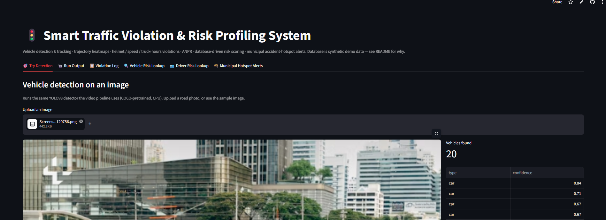
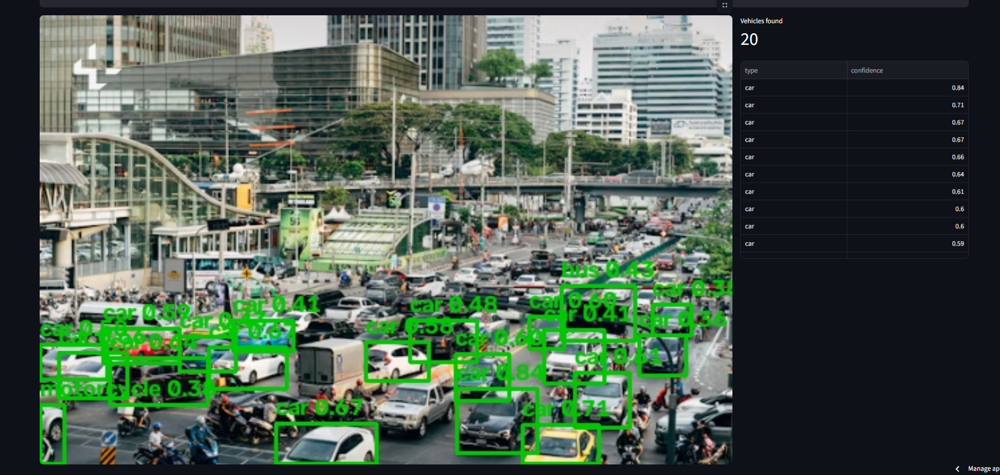

# Smart Traffic Violation & Risk Profiling System

**Live demo:** https://trafficviolation-suryanshu.streamlit.app/ (free tier, may take a minute to wake up)

YOLOv8 vehicle detection + tracking, speed / helmet / truck-hours violation checks, ANPR, a database-backed risk score per vehicle and driver, and accident-hotspot reports per camera, all shown in a Streamlit dashboard. The "Try Detection" tab runs the detector on any road photo you upload.

The full documentation and code are in [`traffic-violation-system/`](traffic-violation-system/README.md).
